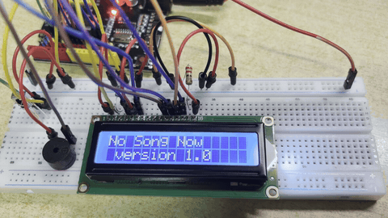
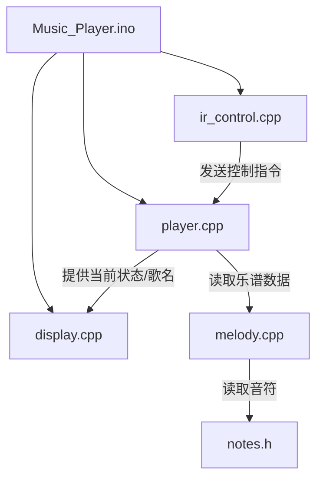

# Arduino 红外遥控音乐播放器

基于 Arduino Uno 的非阻塞多模块音乐播放器。

## 优点
- 非阻塞状态机
- 红外遥控矩阵：支持播放/暂停、上一首、下一首、停止
- 智能多位数输入缓存
- LCD实时状态反馈
- 内存优化

## 演示动图


## 硬件清单 (Hardware Requirements)

| 模块 / 元件 | 规格 / 型号                 | 数量 | 备注 |
| :---------- | :-------------------------- | :--- | :--------------------------------------------------------------------------- |
| **主控板**  | **Arduino Uno (R3)**       | 1    | **必须使用 AVR 架构的板子 (如 Uno, Nano)**，否则代码里的定时器隔离宏会失效 |
| 红外接收头  | HX1838 (或 VS1838B)         | 1    | 需配合 21 键 NEC 协议红外遥控器使用 |
| 显示模块    | LCD1602 (16x2 字符)         | 1    | 需配合 10kΩ 电位器调节对比度 |
| 发声模块    | 无源蜂鸣器 (Passive Buzzer)  | 1    | **注意：必须是无源蜂鸣器**，有源蜂鸣器无法播放不同音高 |
| 电阻 | 220Ω | 1 | **必须**：串联在 LCD 背光引脚（15脚）与 5V 之间，防止烧毁背光 |
| 导线        | 面包板杜邦线                 | 若干 | 建议使用硬线，理线更美观 |
| 其他        | 10kΩ 电位器                 | 1    | 用于调节 LCD 屏幕对比度 |

## 接线说明
### 1. 无源蜂鸣器
| 蜂鸣器引脚               | 连接到 Arduino |
| :----------------------- | :------------- |
| **正极 (长脚 / Signal)** | **D8**         |
| **负极 (短脚 / GND)**    | **GND**        |

### 2. 红外接收头
| 红外接收头引脚       | 连接到 Arduino                     |
| :------------------- | :------------------------------- |
| **VCC (电源)**       | **5V**                           |
| **GND (地)**         | **GND**                          |
| **OUT / DAT (数据)** | **D2**                           |

### 3. LCD1602 屏幕
| LCD1602 引脚 (从左到右) | 功能      | 连接到 Arduino                 |
| :---------------------- | :-------- | :----------------------------- |
| **1 (VSS)**             | 地        | **GND**                        |
| **2 (VDD)**             | 电源      | **5V**                         |
| **3 (V0)**              | 对比度    | 接 **10k 电位器** 的中间脚     |
| **4 (RS)**              | 指令/数据 | **D12**                        |
| **5 (RW)**              | 读/写     | **GND** (固定为写入模式)       |
| **6 (E)**               | 使能      | **D11**                        |
| **7 ~ 10**              | 数据线    | **悬空** (不接)                |
| **11 (D4)**             | 数据线 4  | **D7**                         |
| **12 (D5)**             | 数据线 5  | **D6**                         |
| **13 (D6)**             | 数据线 6  | **D5**                         |
| **14 (D7)**             | 数据线 7  | **D4**                         |
| **15 (A)**              | 背光正极  | 串联 **220Ω 电阻** 后接 **5V** |
| **16 (K)**              | 背光负极  | **GND**                        |

### 4. 10kΩ 电位器 (用于调节屏幕对比度)
| 电位器引脚   | 连接到                |
| :----------- | :-------------------- |
| **左侧引脚** | **5V**                |
| **中间引脚** | **LCD 的引脚 3 (V0)** |
| **右侧引脚** | **GND**               |
> **对比度调节提示**：通电后如果屏幕全亮没有字，拿螺丝刀慢慢旋转电位器，直到屏幕出现清晰的黑色方块或文字为止。

## 快速开始
1. 克隆本项目
2. 使用 Arduino IDE 打开 `Music_Player.ino`
3. **下载IRremote库**：在 Arduino IDE 的库管理器中搜索 IRremote 并安装即可
4. 连接硬件并烧录程序

> **注意**：9号和10号引脚的 PWM 功能已被占用!

## 如何添加你自己的歌曲？

本项目采用极简的数据驱动设计，添加新歌只需要简单的三个步骤，不需要改动任何核心逻辑代码

### 第一步：准备乐谱数据
你需要准备两个数组：**音符频率** 和 **节拍时值**
1. **音符频率**：请参考项目中的 `src/notes.h` 文件，里面包含了从低音到高音的宏定义，宏定义中的字母 s 代表升号（即 #）
2. **节拍时值**：用数字表示, `4` 代表四分音符，`8` 代表八分音符，`2` 代表二分音符
3. **休止符**：使用数字 `0` 来表示停顿/休止符

### 第二步：修改 `src/melody.cpp`
打开 `src/melody.cpp`，在 `const Song song[]` 数组的上方，定义你的新歌数据（**务必保留 `PROGMEM` 关键字**）：

```cpp
// 1. 定义旋律（音符频率）
static const int melody_MySong[] PROGMEM = {
  NOTE_C4, NOTE_D4, NOTE_E4, NOTE_C4
};

// 2. 定义节拍（对应的时值）
static const uint8_t dur_MySong[] PROGMEM = {
  4, 4, 4, 4
};
```

### 第三步：注册歌曲（在 `melody.cpp` 的 `song[]` 中）
将你的新歌加入列表，格式如下：
```cpp
const Song song[] = {
  // ... 之前的歌曲 ...
  // 格式：{"歌名", 旋律数组, 节拍数组, 自动计算长度, BPM }
  { "MySong", melody_MySong, dur_MySong, sizeof(melody_MySong)/sizeof(melody_MySong[0]), 120 }
};
```

## 项目结构
- `Music_Player.ino`：程序主入口，负责初始化与主循环调度。
- `src/`：核心源代码目录。
  - `player.cpp` / `.h`：非阻塞音乐播放状态机。
  - `ir_control.cpp` / `.h`：红外遥控解码与多位数输入逻辑。
  - `display.cpp` / `.h`：LCD 屏幕刷新逻辑。
  - `melody.cpp` / `.h`：歌曲数据结构与乐谱定义。
  - `notes.h`：音符频率宏定义表。



## 开源协议 (License)
本项目基于 [MIT License](LICENSE) 开源。